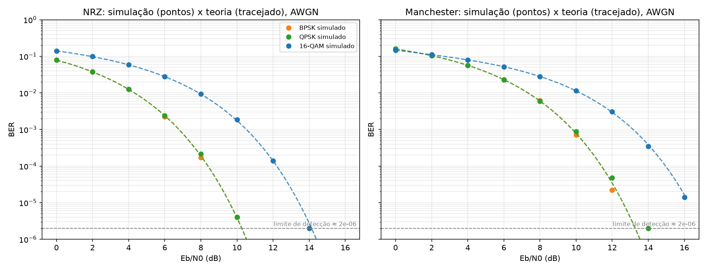
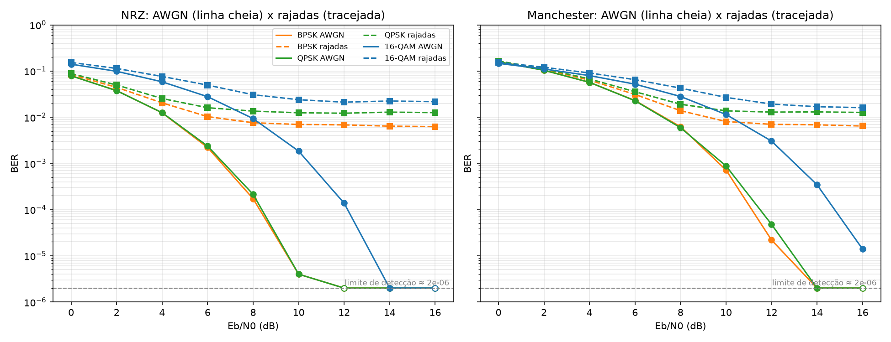
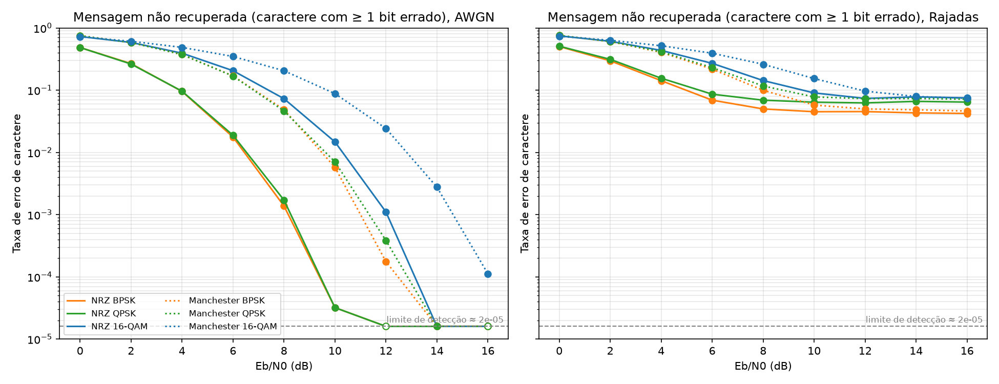
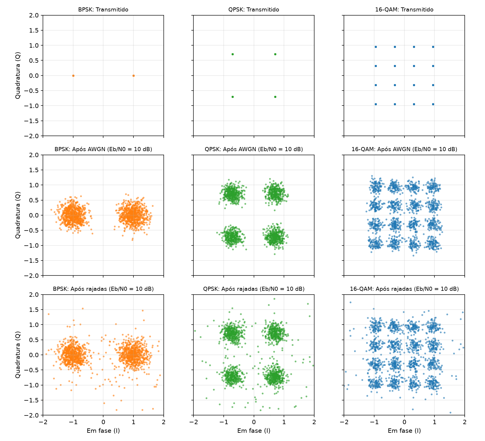

# Simulador de Comunicação Digital

Projeto acadêmico para avaliação experimental de codificação de linha,
modulação digital, canais ruidosos, taxa de erro de bits e eficiência espectral.
O repositório inclui o simulador interativo, o plano de experimentos, os
resultados brutos, gráficos BER × Eb/N0, análise complementar (comparação com a
teoria, AWGN × rajadas, constelações e tabela de compromisso), teste de
consistência e testes automatizados.

## Arquitetura

O fluxo implementado é:

1. A mensagem ASCII é convertida em bits, com oito bits por caractere.
2. O codificador de linha produz níveis `-1/+1`. No NRZ há um nível por bit;
   no Manchester há dois níveis por bit (`0 -> +1,-1` e `1 -> -1,+1`).
3. Cada nível é representado por um *chip bit* (`-1 -> 0`, `+1 -> 1`).
   Esses bits são agrupados e modulados em símbolos complexos.
4. O canal adiciona AWGN ou AWGN com ruído em rajadas aos símbolos modulados.
5. O receptor demodula, remove o preenchimento final usado para completar o
   último símbolo, reconstrói os níveis e decodifica a linha.

Esse desenho evita tratar uma forma de onda de linha como se fosse diretamente
um símbolo QPSK/QAM. A codificação de linha continua sendo observável e
testável, enquanto a modulação trabalha sobre uma sequência binária bem
definida.

### Codificação de linha x correção de erros

Codificação de linha define como os bits são representados fisicamente no
enlace, por exemplo, com os níveis e transições usados por NRZ e Manchester.
Ela pode melhorar propriedades do sinal, como sincronização, mas não adiciona
redundância para recuperar bits corrompidos.

Codificação de correção de erros adiciona bits redundantes à mensagem para que
o receptor detecte e, conforme o código utilizado, corrija erros causados pelo
canal. Este simulador implementa codificação de linha, mas ainda não implementa
um código de correção de erros.

No Manchester, um par de chips sem transição (`+1,+1` ou `-1,-1`) indica que o
canal corrompeu um chip, mas o receptor não sabe qual. Em vez de abortar, o
decodificador decide o bit pelo primeiro chip do par e a quantidade de pares
inválidos é registrada em `results/raw_results.csv`
(`manchester_violations`).

As constelações são normalizadas para potência média unitária: BPSK usa
`±1`, QPSK usa `(±1 ± j)/sqrt(2)` e 16-QAM usa amplitudes
`±1, ±3` divididas por `sqrt(10)`. O AWGN usa
`P_ruído = P_sinal / 10^(SNR_dB/10)`; para ruído complexo, essa potência é
dividida igualmente entre as partes real e imaginária.

## Equipe

- Gustavo Ribeiro Schwert
- João Antonio Astolfi Gonçalves

## Execução do simulador interativo

```text
python -m venv .venv
.venv\Scripts\activate
pip install -r requirements.txt
python main.py
```

O valor de seed é opcional e torna a transmissão reproduzível. O resultado
também informa os índices dos bits incorretos, usando indexação iniciada em
zero.

### Cenários de canal

O cenário AWGN adiciona ruído gaussiano complexo com potência definida pela
SNR informada. O cenário `Ruído em rajadas` mantém esse ruído de fundo e
adiciona ruído de potência configurada em intervalos consecutivos. Cada amostra
inicia uma rajada com probabilidade de 1%, cada rajada dura até 8 amostras e
tem SNR de 0 dB. A mesma seed torna os resultados reproduzíveis.

### Convenção de SNR: Eb/N0

O canal trabalha com a SNR por símbolo (Es/N0), mas todas as comparações e
gráficos usam Eb/N0 (energia por bit de informação), para que modulações e
codificações diferentes recebam o mesmo orçamento de energia por bit. A
conversão é `Es/N0 = k · Eb/N0`, em que `k` é o número de bits de informação
por símbolo (`src/link.py`). Assim, as curvas simuladas podem ser comparadas
com as teóricas.

### Experimentos e gráficos

O plano oficial utiliza 9 valores de Eb/N0: 0, 2, 4, 6, 8, 10, 12, 14 e
16 dB. Cada combinação usa 100.000 bits de informação e 5 repetições
independentes. Os parâmetros são mantidos equivalentes nas comparações.

Execute os experimentos completos:

```text
python -m src.experiments
```

Eles salvam os resultados brutos em `results/raw_results.csv`, os resumos em
`results/summary.csv` e a configuração em `results/config.json`. Para gerar as
curvas BER × Eb/N0 com intervalos de confiança de 95%:

```text
python -m src.plot_results
```

São gerados quatro gráficos em `results/plots/`, combinando cada codificação
de linha com cada cenário de canal. Cada curva identifica a modulação e a
faixa sombreada representa o intervalo de confiança das repetições.

Com 5 repetições de 100.000 bits, o menor BER mensurável é de cerca de
2×10⁻⁶ (um erro em 500 mil bits). Uma BER medida igual a zero significa apenas
"nenhum erro observado", e não BER exatamente nula. Nesses quatro gráficos, os
pontos com BER zero são desenhados no piso `10^-12` apenas como convenção
gráfica; nas figuras da análise complementar (abaixo) eles aparecem como
marcadores vazados sobre a linha do limite de detecção. A geração também pode
ser executada diretamente:

```text
python src\experiments.py --quick
python src\plot_results.py --summary results\summary.csv --out results\plots
```

O modo `--quick` é destinado a testes rápidos e utiliza 10.000 bits e
2 repetições. O plano é determinístico: cada ensaio usa uma seed derivada de
`BASE_SEED = 2026`, da repetição e da combinação de parâmetros, então rodar de
novo reproduz exatamente os mesmos números.

### Análise complementar

```text
python -m src.analysis
```

Gera, a partir de `results/summary.csv`, quatro figuras em `results/plots/`
(`ber_awgn_vs_rajadas.png`, `ber_vs_teoria.png`, `cer_vs_ebn0.png` e
`constelacoes.png`), a tabela de compromisso (`results/tabela_compromisso.md` e
`.csv`) e o relatório do teste de consistência (`results/consistencia.md`). A
taxa de erro de caractere (CER) usada na análise é a fração de caracteres ASCII
(8 bits) com pelo menos um bit errado, que mede a recuperação da mensagem.

### Como reproduzir tudo

```text
python -m pip install -r requirements.txt
python -m pytest -q
python -m src.experiments
python -m src.plot_results
python -m src.analysis
```

## Eficiência espectral

A eficiência espectral nominal considera sinalização ideal, sem roll-off e
sem código de correção de erros. Manchester transmite dois chips por bit,
portanto reduz pela metade a eficiência da mesma modulação em NRZ.

| Codificação | Modulação | Bits por símbolo | Eficiência nominal (bits/s/Hz) |
|---|---|---:|---:|
| NRZ | BPSK | 1 | 1 |
| NRZ | QPSK | 2 | 2 |
| NRZ | 16-QAM | 4 | 4 |
| Manchester | BPSK | 1/2 | 0,5 |
| Manchester | QPSK | 1 | 1 |
| Manchester | 16-QAM | 2 | 2 |

O 16-QAM oferece a maior eficiência espectral, mas exige maior relação
Eb/N0 para atingir uma BER baixa. BPSK é a opção mais robusta, enquanto
QPSK oferece um compromisso intermediário: dobra a eficiência do BPSK sem
utilizar a menor robustez do 16-QAM.

## Resultados experimentais

Os resultados oficiais, com 100.000 bits por ensaio e 5 repetições, estão
registrados em [`results/raw_results.csv`](./results/raw_results.csv),
[`results/summary.csv`](./results/summary.csv) e
[`results/config.json`](./results/config.json). Os gráficos correspondentes
estão em [`results/plots`](./results/plots).

Observações:

- No canal AWGN, a BER diminui de forma consistente à medida que Eb/N0
  aumenta. BPSK e QPSK atingem BER nula nas maiores razões simuladas.
- O 16-QAM mantém maior BER no conjunto de Eb/N0 testado porque seus pontos
  da constelação estão mais próximos uns dos outros.
- O ruído em rajadas cria um patamar residual de BER em valores altos de
  Eb/N0. Isso ocorre porque o ruído intenso continua afetando intervalos
  consecutivos mesmo com o ruído de fundo reduzido.
- Para cada modulação, o canal com rajadas apresenta BER maior que o AWGN
  isolado nas condições analisadas.
- Manchester sofre uma penalidade de eficiência espectral, pois envia duas
  transições/chips por bit. Seu uso é mais adequado quando sincronização por
  transição é mais importante que maximizar a taxa nominal.

### Validação contra a teoria (AWGN)



Os pontos simulados caem sobre as curvas teóricas para as duas codificações
(`ber_theory` em `src/link.py`): BPSK `Q(√(2Eb/N0))`, QPSK igual ao BPSK em
Eb/N0 e 16-QAM com a expressão exata para mapeamento de Gray. No Manchester +
16-QAM, a BER fica abaixo da média do 16-QAM porque o primeiro chip de cada par
cai sempre no bit de sinal, o mais protegido da constelação; a teoria prevê isso
e a simulação confirma.

### AWGN × rajadas



Mesmo com Eb/N0 alto, o canal com rajadas mantém um patamar de erro, enquanto no
AWGN a BER cai até desaparecer dentro do limite de detecção.

### Recuperação da mensagem (taxa de erro de caractere)



No canal com rajadas, mesmo a 16 dB cerca de 4% a 8% dos caracteres chegam
corrompidos (conforme codificação e modulação), contra nenhum erro em AWGN a
12 dB para BPSK/QPSK em NRZ.

### Constelações antes e depois do canal



O AWGN espalha os pontos em nuvens ao redor dos símbolos ideais; as rajadas
adicionam pontos distantes, que cruzam fronteiras de decisão mesmo quando o
ruído de fundo é baixo.

### Tabela de compromisso BER × eficiência espectral

Gerada em `results/tabela_compromisso.md` (e `.csv`):

| Codificação | Modulação | Eficiência (bits/s/Hz) | BER AWGN @ 6 dB | BER AWGN @ 10 dB | Eb/N0 p/ BER ≤ 10⁻³ (dB) | BER rajadas @ 16 dB |
|---|---|---:|---|---|---:|---|
| NRZ | BPSK | 1,0 | 2,2e-03 | 4,0e-06 | 6,6 | 6,3e-03 |
| NRZ | QPSK | 2,0 | 2,4e-03 | 4,0e-06 | 6,7 | 1,3e-02 |
| NRZ | 16-QAM | 4,0 | 2,8e-02 | 1,8e-03 | 10,5 | 2,2e-02 |
| Manchester | BPSK | 0,5 | 2,3e-02 | 7,2e-04 | 9,7 | 6,5e-03 |
| Manchester | QPSK | 1,0 | 2,3e-02 | 8,8e-04 | 9,9 | 1,3e-02 |
| Manchester | 16-QAM | 2,0 | 5,2e-02 | 1,1e-02 | 13,0 | 1,6e-02 |

### Discussão e conclusões

- **BPSK × QPSK**: exigem praticamente o mesmo Eb/N0 (cerca de 6,6 a 6,7 dB para
  BER ≤ 10⁻³), mas o QPSK dobra a eficiência espectral. Em AWGN, é o melhor
  compromisso entre robustez e uso de banda.
- **16-QAM**: quadruplica a eficiência do BPSK, mas precisa de cerca de 4 dB a
  mais de Eb/N0 (10,5 dB) para a mesma BER. Faz sentido em enlaces limpos com
  banda escassa.
- **NRZ × Manchester**: o Manchester não melhora a BER; custa cerca de 3 dB de
  Eb/N0 (9,7 contra 6,6 dB no BPSK; cerca de 2,5 dB no 16-QAM, pelo efeito do bit
  de sinal) e metade da eficiência espectral. Sua vantagem é a transição
  garantida em cada bit (sincronismo, sem componente DC).
- **Rajadas**: criam um piso de erro que aumentar o Eb/N0 não elimina (BPSK
  ≈ 6×10⁻³, QPSK ≈ 1,3×10⁻², 16-QAM ≈ 2,2×10⁻² em NRZ). Como a rajada afeta
  símbolos inteiros, modulações de ordem superior perdem mais bits por rajada.
  Mitigar exigiria codificação de canal com entrelaçamento, fora do escopo.
- **Escolha por cenário**: enlace ruidoso, BPSK; compromisso geral, QPSK; enlace
  limpo e banda escassa, 16-QAM; canal com rajadas, nenhuma modulação resolve
  sozinha.

### Teste de consistência

O relatório `results/consistencia.md` envia a mensagem
`Redes de Computadores - UNISINOS - Trabalho II` (368 bits) por todas as
combinações de codificação e modulação em quatro cenários, informando bits e
caracteres incorretos e se a mensagem foi recuperada:

- **Canal ideal** e **AWGN a 30 dB**: mensagem recuperada sem erros em todas as
  combinações, o que valida o pipeline ponta a ponta.
- **AWGN a 6 dB**: surgem erros na maioria das combinações (o NRZ + BPSK pode
  passar sem erros por ser a mais robusta); 16-QAM e Manchester erram mais.
- **Rajadas a 16 dB**: restam erros isolados mesmo com Eb/N0 alto, o que explica
  a divergência: é o piso de erro das rajadas, não uma falha do receptor.

Como a mensagem tem poucos bits, a contagem de erros é ilustrativa e depende da
seed; as estatísticas confiáveis vêm do experimento com 100.000 bits e 5
repetições.

## Vídeo de demonstração

_Em breve: link ou arquivo do vídeo

## Testes

```text
python -m pytest -q
```

Os testes cobrem conversão ASCII, codificações de linha (incluindo Manchester
com pares inválidos), modulações, reprodutibilidade dos canais, métricas,
conversão Eb/N0, concordância com a BER teórica, experimentos, geração de
resumos e gráficos, análise complementar e teste de consistência.
